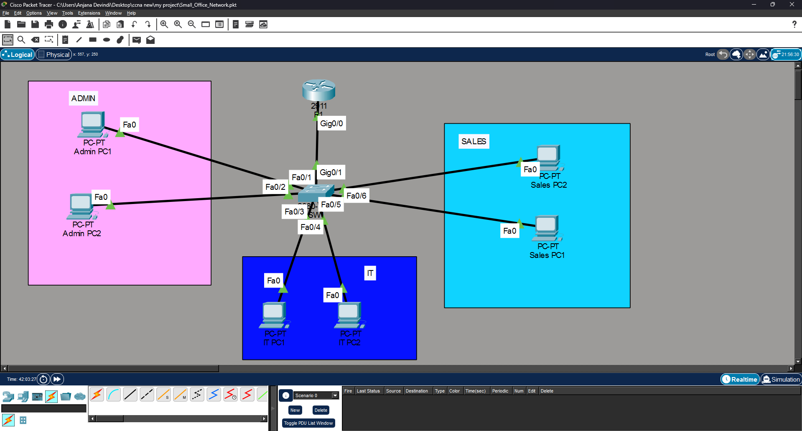
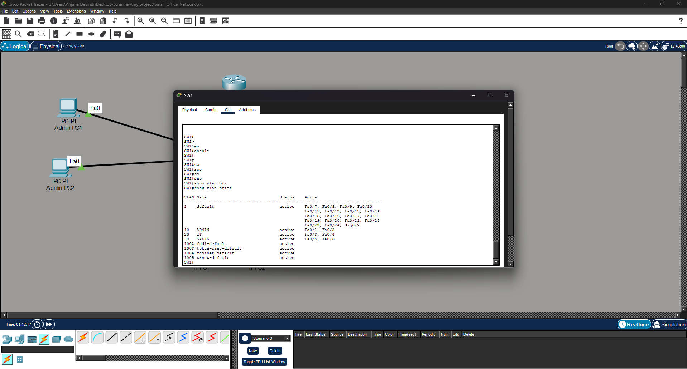
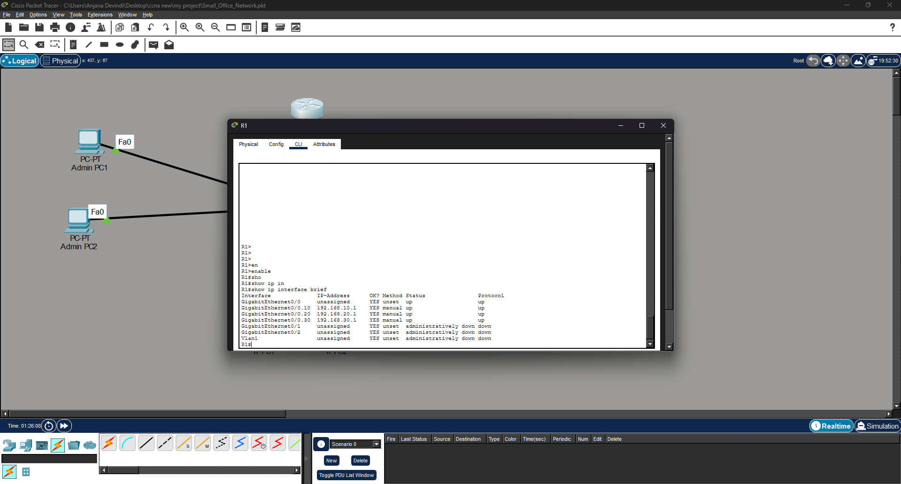

# Small Office Network Architecture & Configuration

**Status: Baseline implemented in Packet Tracer; topology, VLAN, and router interface screenshots available. Security extensions and the .pkt upload are pending.**

An educational Cisco Packet Tracer project to design and configure a small office network with department VLANs, router-on-a-stick inter-VLAN routing, and DHCP. Security controls and simulated internet connectivity are planned extensions.

This Packet Tracer lab is separate from the repository's GNS3 multi-site WAN lab.

## Equipment
- 1 Cisco 2911 router: R1
- 1 Cisco 2960 switch: SW1
- 6 PCs: two each for Admin, IT, and Sales
- Copper straight-through cables

## Addressing

| Department | VLAN | Subnet | Gateway |
|---|---|---|---|
| Admin | 10 | 192.168.10.0/24 | 192.168.10.1 |
| IT | 20 | 192.168.20.0/24 | 192.168.20.1 |
| Sales | 30 | 192.168.30.0/24 | 192.168.30.1 |

Addresses .1–.20 in each subnet are reserved; the remaining usable addresses are available through DHCP.

## Connections

| Device port | SW1 port |
|---|---|
| R1 Gi0/0 | Gi0/1 (trunk) |
| Admin-PC1 Fa0 | Fa0/1 |
| Admin-PC2 Fa0 | Fa0/2 |
| IT-PC1 Fa0 | Fa0/3 |
| IT-PC2 Fa0 | Fa0/4 |
| Sales-PC1 Fa0 | Fa0/5 |
| Sales-PC2 Fa0 | Fa0/6 |

## Build instructions
1. Place and cable the listed devices in Packet Tracer.
2. Open each network device's CLI. Decline the initial configuration dialog if prompted.
3. Paste [SW1 configuration](configs/SW1.txt) into the switch and [R1 configuration](configs/R1.txt) into the router, starting from the user EXEC prompt.
4. Press Enter when asked to accept the startup configuration filename.
5. On every PC, choose **Desktop → IP Configuration → DHCP**.
6. Complete the checks below.
7. Save the topology as `Small_Office_Network.pkt` and upload it to this folder.

## Validation checklist
Screenshots confirm VLAN assignments and router interface status. DHCP output and successful connectivity tests were reported by the author during the guided build; ping screenshots are still to be added.

- [x] `show vlan brief` on SW1 shows the correct access ports.
- [x] `show interfaces trunk` on SW1 shows Gi0/1 carrying VLANs 10,20,30.
- [x] `show ip interface brief` on R1 shows Gi0/0 and its subinterfaces up/up.
- [x] `show ip dhcp binding` on R1 shows the PC leases.
- [ ] Each PC receives the correct subnet mask, address, and gateway.
- [ ] Each PC can ping its gateway.
- [x] PCs in the same VLAN can ping each other.
- [x] PCs in different VLANs can ping each other.
- [ ] Save, reopen, and verify the Packet Tracer project.

Use `ipconfig` on each PC to identify its assigned address before testing. An initial ping can time out while ARP resolves; repeat it.

## Security scope
The initial configuration permits communication between all three departments. VLANs separate broadcast domains; they do not prevent routed access. This baseline is not a completed secure deployment.

Planned extensions:
- [ ] ACLs with a documented department access policy
- [ ] SSH management
- [ ] Switch port security
- [ ] Shutdown of unused switch ports
- [ ] ISP simulation, default route, and NAT/PAT
- [ ] Positive and negative tests for access restrictions

## Evidence

### Network topology

### VLAN assignments
VLAN 10 uses Fa0/1–2, VLAN 20 uses Fa0/3–4, and VLAN 30 uses Fa0/5–6.

### Router interface status
Gi0/0 and subinterfaces .10, .20, and .30 are up/up with the expected gateway addresses.

### DHCP leases
The following addresses were confirmed in the author's pasted `show ip dhcp binding` output:

| Department | PC1 | PC2 |
|---|---|---|
| Admin | 192.168.10.21 | 192.168.10.22 |
| IT | 192.168.20.21 | 192.168.20.22 |
| Sales | 192.168.30.21 | 192.168.30.22 |

Reported successful tests: Admin-PC1 to its gateway, Admin-PC1 to Admin-PC2, Admin-PC1 to IT-PC1 and Sales-PC1, and IT-PC1 to Sales-PC1. Ping screenshots have not yet been uploaded.

## Remaining deliverables
- `Small_Office_Network.pkt`
- DHCP binding and ping screenshots
- Save/reopen verification
- Security extensions and their positive/negative test results
